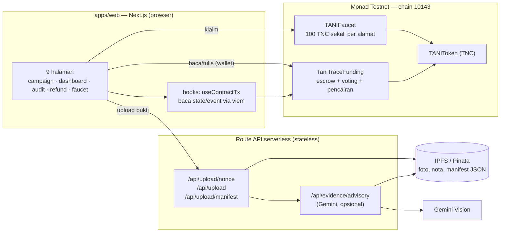

<div align="center">

# 🌾 TaniTrace

<h3>Pendanaan pertanian transparan: petani mengajukan dana, investor yang menyetujui setiap pencairan lewat voting on-chain.</h3>

<p>
<a href="https://github.com/fardannozami/tani-trace"></a>
<a href="https://docs.monad.xyz/developer-essentials/testnet"></a>


</p>

<p>


</p>

<b><a href="#-coba-sekarang">Coba sekarang</a></b> ·
<a href="#-masalah--solusi">Masalah &amp; solusi</a> ·
<a href="#%EF%B8%8F-arsitektur">Arsitektur</a> ·
<a href="#-smart-contract">Kontrak</a> ·
<a href="#-menjalankan-di-lokal-langkah-demi-langkah">Jalankan lokal</a> ·
<a href="#-skenario-demo">Demo</a> ·
<a href="#-test">Test</a>

<sub>Monad Blitz · Monad Testnet (chain ID 10143) · token simulasi TNC tanpa nilai uang</sub>

</div>

---

TaniTrace adalah protokol pendanaan pertanian di **Monad Testnet**. Petani membuat
campaign dengan target dan tenggat; investor menyetor token simulasi **TNC**;
dana dikunci di smart contract (escrow). Saat petani butuh dana untuk benih,
pupuk, atau tenaga kerja, ia mengajukan pencairan. **Investor campaign itulah yang
memutuskan** lewat voting 40 detik untuk mode demo — bukan admin. Jika disetujui, contract
mentransfer dana tepat sebesar nominal yang disetujui, satu kali.

Foto dan nota bukti disimpan di **IPFS**; hash manifest-nya dicatat on-chain
sehingga field pengajuan tidak bisa diubah diam-diam. Pemeriksaan awal berbasis
**AI (Gemini)** hanya bersifat *advisory*: hasilnya tidak pernah menjadi keputusan
on-chain dan tidak pernah memblokir transaksi.

> **Status:** kontrak **sudah live di Monad Testnet** (alamat di
> [bawah](#alamat-kontrak), tercatat di
> [`deployments/monadTestnet.json`](deployments/monadTestnet.json)). Frontend
> production sudah live di **[tanitrace.web.id](https://www.tanitrace.web.id/)**.
> Semua test dan build lulus.

## 🖥️ Tampilan aplikasi

TaniTrace memiliki tiga area utama untuk menjelaskan alur pendanaan dari awal
hingga pencairan:

1. **Landing page** — memperkenalkan pendanaan tani yang transparan, metrik
   campaign aktif, dan tombol untuk menjelajahi atau membuat campaign.
2. **Campaign** (`/campaigns`) — menampilkan daftar campaign pertanian dalam
   bentuk kartu, lengkap dengan kategori, status, lokasi, progres dana, target,
   pemilik campaign, dan batas waktu. Filter tersedia untuk semua,
   pendanaan, aktif, gagal, dan selesai.
3. **Dashboard** (`/dashboard`) — ruang kerja petani untuk memilih campaign,
   mengunggah bukti ke IPFS, mengisi nominal serta tujuan pencairan, lalu
   mengajukan pencairan. Investor kemudian meninjau pengajuan dan memberikan
   suara melalui alur voting on-chain.

Navigasi utama juga menyediakan halaman **Voting**, **Audit**, dan **Faucet**.
Wallet yang terhubung ditampilkan di header, sementara seluruh status penting
dan keputusan akhir tetap bersumber dari smart contract Monad.

| | |
| --- | --- |
| 🌐 **Aplikasi** | [www.tanitrace.web.id](https://www.tanitrace.web.id/) · [jalankan lokal](#-menjalankan-di-lokal-langkah-demi-langkah) |
| 🔗 **Deploy** | Monad Testnet, blok `73746544` · [deployments/monadTestnet.json](deployments/monadTestnet.json) |
| 📜 **Kontrak** | `contracts/src/` — `TANIToken`, `TANIFaucet`, `TaniTraceFunding` |
| 🧑‍⚖️ **Judging** | [Evidence checklist](docs/judging-checklist.md) |
| 📣 **Build in public** | [Posting & demo kit](docs/build-in-public-kit.md) |
| ✅ **Hasil uji** | `forge test` **106 lulus** · Vitest **52 lulus** · `tsc`, ESLint, `next build` lulus |
| ⛓️ **Jaringan** | Monad Testnet · chain ID `10143` · gas dibayar dalam **MON** |
| 🪙 **Token** | TNC ("Tani Token") · Contract: [`0x25e6a951D7a3d7F5C76BF24E098E7878f37007f3`](https://testnet.monadexplorer.com/address/0x25e6a951D7a3d7F5C76BF24E098E7878f37007f3) (18 desimal) |
| 🧾 **Testnet saja** | TNC tidak punya nilai uang dan tidak bisa ditukar |

<details>
<summary><b>English summary</b></summary>

TaniTrace is a transparent agricultural funding protocol on Monad Testnet
(chain ID 10143). A farmer creates a campaign with a target and a deadline.
Investors fund it with a simulated ERC-20 token, **TNC**, held in the funding
contract escrow. When the farmer needs money during the growing season, they
submit a disbursement request (amount, purpose, IPFS evidence CID). The contract
records a canonical `manifestHash`, opens a 40-second demo vote, and only contributing
investors may vote, weighted by their recorded contribution (not their current
wallet balance). A request passes only if quorum — 50% of `totalRaised`, rounded
up — is met and YES weight exceeds NO. Anyone can finalize after the deadline
(`APPROVED` / `REJECTED` / `EXPIRED`), and only the farmer can pay an approved
request, exactly once. Failed campaigns (`FAILED`) allow one refund per
contributor. Evidence files are pinned to IPFS through a server-side Pinata
adapter authorised with a nonce, an EIP-191 signature and an HMAC token; the
frontend recomputes the manifest hash and compares it with the on-chain value. An
optional Gemini-based pre-check is advisory only: it is stored inside the IPFS
manifest, excluded from the hash, and never blocks uploads, transactions, or
on-chain logic. There is no admin, no pause, no upgrade path, and no permanent
backend or database. Tests: 106 Foundry (unit, fuzz, invariant) and 52 frontend
(Vitest). The contracts are deployed on Monad Testnet (see
`deployments/monadTestnet.json`); the production frontend is live at
`https://www.tanitrace.web.id/`.
</details>

## 🚀 Coba sekarang

Yang perlu disiapkan: browser + wallet (MetaMask atau wallet EIP-1193 lain) dan
sedikit **MON testnet** untuk gas. Tidak perlu uang sungguhan.

> **Demo publik:** buka [www.tanitrace.web.id](https://www.tanitrace.web.id/),
> hubungkan wallet, lalu pastikan wallet berada di Monad Testnet. Untuk
> development atau deployment ulang, ikuti panduan lokal di bawah.

### Langkah mencoba

1. **Siapkan wallet.** Install [MetaMask](https://metamask.io/download/) (atau
   wallet lain yang mendukung jaringan EVM kustom).
2. **Tambahkan jaringan Monad Testnet** di wallet:

   | Isian | Nilai |
   | --- | --- |
   | Nama jaringan | Monad Testnet |
   | RPC URL | `https://testnet-rpc.monad.xyz` |
   | Chain ID | `10143` |
   | Simbol mata uang | `MON` |
   | Block explorer | `https://testnet.monadexplorer.com` |

3. **Ambil MON gratis** di [faucet resmi Monad](https://faucet.monad.xyz)
   (butuh login sosial/alamat wallet; ada syarat saldo di beberapa faucet —
   lihat [dokumentasi faucet](https://docs.monad.xyz/developer-essentials/faucet)).
   **Deploy butuh sekitar 1–2 MON** (3 kontrak, ~5,3 juta gas); satu transaksi
   biasa sesudahnya hanya ~0,01 MON.
4. **Buka aplikasi** [www.tanitrace.web.id](https://www.tanitrace.web.id/),
   klik **Hubungkan wallet**, lalu setujui perpindahan jaringan ke Monad Testnet.
   Aplikasi menolak transaksi jika wallet berada di chain lain.
5. **Klaim TNC** di `/faucet` (100 TNC per alamat, sekali).

   > 💡 **Cara Menambahkan / Import Token TNC ke MetaMask:**  
   > Agar saldo TNC langsung muncul di wallet Anda setelah klaim:
   > - Buka MetaMask ➔ Pilih jaringan **Monad Testnet**.
   > - Masuk ke tab **Tokens** ➔ Klik **Import tokens**.
   > - **Token Contract Address:** `0x25e6a951D7a3d7F5C76BF24E098E7878f37007f3`
   > - **Token Symbol:** `TNC`
   > - **Token Decimal:** `18`
   > - Klik **Next** ➔ **Import**. Saldo 100 TNC Anda akan langsung muncul di MetaMask!
6. **Coba alurnya** (peran bisa berganti-ganti wallet):

   | Peran | Halaman | Yang dilakukan |
   | --- | --- | --- |
   | Investor | `/faucet` → `/campaigns/[id]` | klaim TNC, approve allowance, kontribusi |
   | Petani | `/campaigns/new` | buat campaign (target + deadline) |
   | Petani | `/dashboard` | unggah bukti ke IPFS, ajukan pencairan |
   | Investor | `/campaigns/[id]/requests/[requestId]` | cek hash manifest, vote YES/NO |
   | Siapa pun | halaman request | `finalizeRequest` setelah 40 detik |
   | Petani | halaman request | `payDisbursement` jika `APPROVED` |
   | Petani | `/dashboard` | `completeCampaign` setelah kewajiban selesai |
   | Semua | `/audit` | lihat seluruh event on-chain + tautan explorer |
   | Kontributor | `/refund` | refund jika campaign `FAILED` |

7. **Voting demo berlangsung 40 detik.** Setelah deadline lewat, siapa pun dapat
   memanggil `finalizeRequest`: suara YES lebih besar dan kuorum tercapai menjadi
   `APPROVED`, mayoritas NO menjadi `REJECTED`, dan suara di bawah kuorum menjadi
   `EXPIRED`. Voting tidak bisa menerima suara baru setelah deadline.

## 🌾 Masalah & solusi

Petani kecil sering butuh modal di tengah masa tanam, tetapi pemberi dana sulit
melihat: berapa dana terkumpul, untuk apa uang diminta, siapa yang setuju, kapan
dana cair, dan bukti apa yang mendasarinya. Ketergantungan pada satu pihak yang
memegang uang juga membuat pencairan tidak transparan.

TaniTrace memindahkan aturan itu ke smart contract:

- **Escrow, bukan titipan pribadi.** Dana kontribusi terkunci di contract.
  Tidak ada admin yang bisa menariknya; sisa escrow yang tidak pernah diajukan
  tetap di contract dan tidak bisa diambil sepihak.
- **Pencairan harus disetujui investor.** Setiap pengajuan membuka voting 40 detik
  pada deployment demo ini; gunakan durasi lebih panjang sebelum produksi.
  Bobot suara = kontribusi tercatat (bukan saldo wallet saat ini), satu alamat
  satu suara per pengajuan. Kuorum 50% dibulatkan ke atas; YES harus lebih besar
  dari NO.
- **Bukti tidak bisa diubah diam-diam.** `manifestHash` on-chain adalah komitmen
  terhadap `(campaignId, requestId, farmer, amount, purpose, evidenceCid,
  requestedAt)`. Frontend menghitung ulang hash-nya dan membandingkan dengan nilai
  on-chain — jika ada yang diubah, verifikasi gagal.
- **AI hanya membantu, tidak memutuskan.** Pemeriksaan awal Gemini memberi catatan
  (mis. "foto tidak cocok dengan tujuan") tanpa memblokir apa pun. Keputusan tetap
  di voting investor dan contract.
- **Kegagalan ditangani jelas.** Target tidak tercapai → campaign `FAILED` →
  refund satu kali per kontributor. Pengajuan tanpa kuorum → `EXPIRED`. YES tidak
  lebih besar dari NO → `REJECTED`.
- **Semua bisa diaudit.** 10 event on-chain (`CampaignCreated`,
  `ContributionMade`, `CampaignActivated`, `CampaignFailed`,
  `DisbursementRequested`, `VoteCast`, `RequestFinalized`, `DisbursementPaid`,
  `RefundClaimed`, `CampaignCompleted`) tampil di `/audit` dengan tautan
  transaksi.

Contoh angka (satuan TNC, sama seperti di test):

| Kejadian | Nilai |
| --- | --- |
| Target campaign | 1.000 TNC |
| Investor A / B | 600 / 400 TNC (bobot suara sama dengan kontribusi) |
| Pengajuan benih | 300 TNC → `PENDING` (voting 40 detik pada mode demo) |
| Suara | A YES 600, B NO 400 → kuorum 500 tercapai, YES > NO → `APPROVED` |
| Pencairan | petani menerima tepat 300 TNC; `releasedTotal` = 300 |
| Escrow tersisa | 700 TNC (bisa diajukan lagi atau tetap di contract) |

## 🏗️ Arsitektur

Tidak ada database dan tidak ada server yang menyimpan data bisnis:

- **Smart contract** menyimpan status, kontribusi, suara, hash, dan dana.
- **IPFS (Pinata)** menyimpan berkas bukti dan manifest JSON.
- **Next.js** hanya membaca state/event lewat RPC dan menjadi adapter upload.
- **Route API serverless** bersifat stateless: memberi nonce, memverifikasi tanda
  tangan wallet (EIP-191) + token HMAC, meneruskan file ke Pinata, dan (opsional)
  memanggil Gemini. Verifikasi memakai `expiresAt` yang diikat token HMAC, bukan
  penyimpanan in-memory, sehingga tetap bekerja lintas instance route.



| Bagian | Teknologi |
| --- | --- |
| Kontrak | Solidity `0.8.28`, Foundry, OpenZeppelin v5 (`ERC20`, `SafeERC20`, `ReentrancyGuard`) |
| Web | Next.js 15 (App Router), React 19, TypeScript, wagmi v2, viem, TanStack Query, CSS di `globals.css` |
| Bukti | IPFS via Pinata; manifest JSON kanonis |
| AI | Gemini (default `gemini-2.5-flash`, opsional) |
| Test | Foundry (unit/fuzz/invariant), Vitest |

### Alur data

1. Petani `createCampaign` → status `FUNDING`.
2. Investor `contribute` (setelah approve allowance) sebelum deadline. Jumlah
   maksimal adalah sisa target (`targetAmount - totalRaised`); UI menghitung
   sisa itu, membatasi input, dan menolak jumlah yang kelebihan sebelum
   transaksi dikirim. Ketika `totalRaised == targetAmount`, campaign otomatis
   menjadi `ACTIVE` dan kontribusi ditutup.
3. Deadline lewat → status on-chain **tetap `FUNDING`** sampai ada yang
   memanggil `finalizeCampaign` (permissionless, siapa saja). Selama itu UI
   menandai "Menunggu finalisasi" dan menyembunyikan form kontribusi. Saat
   difinalisasi: target tercapai → `ACTIVE`, target tidak tercapai → `FAILED`
   (kontributor bisa `claimRefund`).
4. Petani upload bukti ke IPFS → `requestDisbursement` → status `PENDING`,
   voting 40 detik pada mode demo, `manifestHash` dihitung on-chain.
5. Investor `vote(requestId, support)`; bobot = kontribusi tercatat.
6. Siapa pun `finalizeRequest` setelah deadline →
   `APPROVED` / `REJECTED` / `EXPIRED`.
7. Jika `APPROVED`, petani `payDisbursement` → `PAID` (sekali).
8. Petani `completeCampaign` setelah tidak ada pengajuan aktif maupun
   `APPROVED` yang belum dibayar → `COMPLETED`.

## 📜 Smart contract

Semua kontrak ada di [`contracts/src/`](contracts/src).

| Kontrak | Fungsi |
| --- | --- |
| `TANIToken` | ERC-20 "Tani Token" simbol **TNC**, 18 desimal, supply tetap 1.000.000, dicetak sekali ke deployer, tanpa mint publik/owner/admin/pause |
| `TANIFaucet` | Saldo TNC pra-isi, satu klaim per alamat, `claimAmount` immutable (default 100 TNC) |
| `TaniTraceFunding` | Campaign, kontribusi ERC-20, pengajuan, voting 40 detik pada mode demo, finalisasi permissionless, pencairan satu kali, refund, penutupan campaign, view ber-paginasi |

Fungsi tulis: `createCampaign`, `contribute`, `finalizeCampaign`,
`requestDisbursement`, `vote`, `finalizeRequest`, `payDisbursement`,
`claimRefund`, `completeCampaign`.

Fungsi baca: `getCampaign`, `getRequest`, `getVote`, `availableEscrow`,
`computeManifestHash`, `getCampaignIds`, `getContributors`,
`getCampaignRequestIds` (`offset`/`limit`, maks **100** per halaman).

| Konstanta | Nilai |
| --- | --- |
| `VOTING_PERIOD` | 40 detik (demo) |
| `QUORUM_BPS` / `BPS_DENOMINATOR` | 5.000 / 10.000 (50%) |
| `MAX_TITLE_LENGTH` | 96 |
| `MAX_CROP_TYPE_LENGTH` | 48 |
| `MAX_LOCATION_LENGTH` | 120 |
| `MAX_PLAN_LENGTH` | 600 |
| `MAX_PURPOSE_LENGTH` | 96 |
| `MAX_CID_LENGTH` | 128 |
| `MAX_PAGE_SIZE` | 100 |

Keamanan: `SafeERC20` + `ReentrancyGuard`, checks-effects-interactions, tolak
token fee-on-transfer, satu pengajuan aktif + satu `APPROVED` belum dibayar per
campaign, pencairan/refund satu kali, tanpa loop tak terbatas pada fungsi tulis.

### Perhitungan voting

- Kuorum = `ceil(totalRaised × 5000 / 10000)`, yaitu
  `(totalRaised * 5000 + 9999) / 10000`.
- `totalVoted = yesWeight + noWeight`.
- `totalVoted < kuorum` (termasuk tanpa suara) → `EXPIRED`.
- Kuorum tercapai dan `yesWeight > noWeight` → `APPROVED`.
- Kuorum tercapai dan `yesWeight ≤ noWeight` (termasuk seri) → `REJECTED`.

### Hash manifest

```
keccak256(abi.encode(
  keccak256("TaniTrace.DisbursementManifest.v1"),
  campaignId, requestId, farmer, amount, purpose, evidenceCid, requestedAt
))
```

`requestedAt` adalah `block.timestamp` saat pengajuan. Frontend mereproduksi nilai
ini dengan viem (`apps/web/lib/manifest.ts`) dan membandingkannya dengan
`request.manifestHash`; hasilnya ditampilkan sebagai ✓ cocok / ✗ tidak cocok.
`evidenceCid` menunjuk bundel JSON bukti di IPFS, bukan hash byte JSON.

### Alamat kontrak

**Monad Testnet (chain 10143)** — sudah dideploy. Sumber kebenaran:
[`deployments/monadTestnet.json`](deployments/monadTestnet.json).

| Kontrak | Alamat | Explorer |
| --- | --- | --- |
| TANIToken (TNC) | `0x29171a923080d86e84bBAb98E12BE517bA432ac1` | [lihat](https://testnet.monadexplorer.com/address/0x29171a923080d86e84bBAb98E12BE517bA432ac1) |
| TaniTraceFunding | `0x3dbCEB5dE079012A32662E8FeaF74E6b06B13F0A` | [lihat](https://testnet.monadexplorer.com/address/0x3dbCEB5dE079012A32662E8FeaF74E6b06B13F0A) |
| TANIFaucet | `0x647d112774F76a2ceC6C409ce823158D8d2a4Aba` | [lihat](https://testnet.monadexplorer.com/address/0x647d112774F76a2ceC6C409ce823158D8d2a4Aba) |

Deployer `0x7210716f612812374Fa2FF4cf6b3467f55ffd8fC`, blok `73746544`.
Token: `name()` = `Tani Token`, `symbol()` = `TNC`, `totalSupply()` = 1.000.000,
faucet `claimAmount()` = 100 TNC.

#### 🪙 Parameter Import Token TNC ke Wallet (MetaMask / Rabby)

| Parameter | Nilai |
| --- | --- |
| **Token Contract Address** | `0x25e6a951D7a3d7F5C76BF24E098E7878f37007f3` |
| **Token Symbol** | `TNC` |
| **Token Decimals** | `18` |

Nilai untuk `apps/web/.env.local` (hanya alamat publik, bukan rahasia):

```env
NEXT_PUBLIC_TOKEN_ADDRESS=0x29171a923080d86e84bBAb98E12BE517bA432ac1
NEXT_PUBLIC_FUNDING_ADDRESS=0x3dbCEB5dE079012A32662E8FeaF74E6b06B13F0A
NEXT_PUBLIC_FAUCET_ADDRESS=0x647d112774F76a2ceC6C409ce823158D8d2a4Aba
NEXT_PUBLIC_DEPLOY_BLOCK=73746544
```

Deployment yang tercantum di atas adalah deployment terverifikasi sebelumnya.
Karena mode demo sekarang memakai voting 40 detik, deploy ulang kontrak Funding
dan verifikasi ulang source sebelum demo berikutnya; alamat baru harus diambil
dari `deployments/monadTestnet.json` dan dipakai untuk env frontend.

## 💻 Menjalankan di lokal (langkah demi langkah)

Panduan ini ditulis untuk yang belum pernah menjalankan proyek Web3. Ikuti
urutannya; tidak ada langkah yang butuh akun berbayar.

### 1. Pasang perkakas

| Perkakas | Untuk apa | Cara pasang |
| --- | --- | --- |
| **Git** | mengambil kode | [git-scm.com](https://git-scm.com/downloads) |
| **Node.js 20+** | menjalankan frontend | [nodejs.org](https://nodejs.org) (pilih LTS) |
| **Bun** | install dependency & script | [bun.sh](https://bun.sh) (`curl -fsSL https://bun.sh/install \| bash`) |
| **Foundry** | compile/test/deploy kontrak | [book.getfoundry.sh](https://book.getfoundry.sh/getting-started/installation) |

Cek instalasi: `git --version`, `node --version`, `bun --version`, `forge --version`.

### 2. Ambil kode dan dependency

```bash
git clone https://github.com/fardannozami/tani-trace.git
cd tani-trace
bash contracts/script/setup.sh          # install OpenZeppelin + forge-std, lalu forge build
cd apps/web && bun install && cd ../..
```

### 3. Isi environment

```bash
# hanya membuat jika belum ada, supaya isian lama tidak tertimpa
[ -f contracts/.env ] || cp .env.example contracts/.env
[ -f apps/web/.env.local ] || cp apps/web/.env.example apps/web/.env.local
```

Kalau `contracts/.env` sudah ada tapi deploy bilang
`environment variable MONAD_TESTNET_RPC not found`, berarti perintah di atas
dijalankan dari folder yang salah atau file-nya belum dibuat — pastikan file itu
ada **di dalam** `contracts/`.
**`contracts/.env`** (dipakai Foundry):

| Variabel | Wajib | Arti |
| --- | --- | --- |
| `PRIVATE_KEY` | deploy | private key wallet deployer (jangan di-commit) |
| `MONAD_TESTNET_RPC` | ya | `https://testnet-rpc.monad.xyz` |
| `FAUCET_ALLOCATION` | tidak | TNC yang diisi ke faucet saat deploy (default `200000`) |
| `FAUCET_CLAIM_AMOUNT` | tidak | TNC per klaim (default `100`) |
| `DEPLOYMENT_OUT` | tidak | path output deploy (default `../deployments/monadTestnet.json`) |

#### Dari mana `PRIVATE_KEY`?

Private key **berasal dari wallet Anda sendiri** — Monad dan faucet tidak
menerbitkannya. Jangan pakai wallet utama yang berisi aset sungguhan; buat akun
khusus testnet.

**Cara A — ekspor dari MetaMask**

1. Buka MetaMask → pilih akun (idealnya akun baru khusus testnet).
2. Titik tiga → **Account details** → **Show private key** → masukkan password.
3. Salin, lalu tempel di `contracts/.env` sebagai `PRIVATE_KEY=0x...`.

**Cara B — buat akun sekali pakai dengan Foundry**

```bash
cast wallet new
# Address:     0x...
# Private key: 0x...
```

Simpan private key ke `contracts/.env`, lalu kirim MON testnet ke **Address**
yang tercetak (faucet mengirim MON ke alamat, bukan ke private key).

| Istilah | Isi | Dipakai di sini? |
| --- | --- | --- |
| **Private key** | 64 karakter hex (`0x...`), menguasai satu akun | ✅ isi `PRIVATE_KEY` |
| **Secret recovery phrase** (12/24 kata) | menguasai **semua** akun di wallet | ❌ jangan ditempel ke mana pun |

Cek dulu bahwa key dan alamat cocok, dan alamat itu punya MON (jalankan dari root
repo):

```bash
cast wallet address --private-key "$(grep '^PRIVATE_KEY=' contracts/.env | cut -d= -f2-)"
cast balance <alamat-di-atas> --rpc-url https://testnet-rpc.monad.xyz
```

> Private key = akses penuh ke akun. Jangan pernah mengirimkannya lewat chat,
> screenshot, issue, atau commit. `contracts/.env` sudah di-gitignore.

**`apps/web/.env.local`** (dipakai frontend):

| Variabel | Wajib | Arti |
| --- | --- | --- |
| `NEXT_PUBLIC_MONAD_TESTNET_RPC` | ya | RPC Monad Testnet |
| `NEXT_PUBLIC_TOKEN_ADDRESS` | ya | alamat `TANIToken` |
| `NEXT_PUBLIC_FUNDING_ADDRESS` | ya | alamat `TaniTraceFunding` |
| `NEXT_PUBLIC_FAUCET_ADDRESS` | ya | alamat `TANIFaucet` |
| `NEXT_PUBLIC_DEPLOY_BLOCK` | ya | blok deploy, dipakai membatasi `getLogs` |
| `NEXT_PUBLIC_IPFS_GATEWAY` | ya | `https://gateway.pinata.cloud` |
| `PINATA_JWT` | upload | JWT Pinata (server-only) |
| `PINATA_GATEWAY` | upload | gateway Pinata (server-only) |
| `UPLOAD_SIGNING_SECRET` | upload | secret HMAC untuk nonce/token (server-only) |
| `UPSTASH_REDIS_REST_URL` | upload | URL REST Upstash untuk nonce serverless |
| `UPSTASH_REDIS_REST_TOKEN` | upload | token REST Upstash (server-only) |
| `GEMINI_API_KEY` | opsional | kosong = advisory dilewati, alur tetap jalan |
| `GEMINI_MODEL` | opsional | default `gemini-2.5-flash` |

> Variabel `NEXT_PUBLIC_*` ikut terkirim ke browser. Jangan pernah menaruh secret
> di prefix itu. Env dibaca saat startup — **restart** dev server setelah diubah.
> Di Vercel, isi kedua variabel Upstash pada environment Production lalu redeploy.

### 4. Deploy kontrak ke Monad Testnet

Butuh MON testnet di wallet deployer (lihat
[Coba sekarang](#-coba-sekarang) langkah 3). `contracts/.env` **harus ada** dan
berisi `PRIVATE_KEY` (64 karakter hex, boleh dengan atau tanpa awalan `0x`).
Foundry hanya memuat `.env` dari folder tempat `forge` dijalankan, yaitu
`contracts/`. Belum punya private key? Lihat
[Dari mana `PRIVATE_KEY`](#dari-mana-private_key).

```bash
cd contracts
forge build                 # kompilasi
forge script script/Deploy.s.sol --rpc-url monad_testnet                 # dry-run
forge script script/Deploy.s.sol --rpc-url monad_testnet --broadcast     # kirim
```

Atau dari root repo, deploy sekaligus memperbarui alamat kontrak di
`apps/web/.env.local`:

```bash
bash scripts/deploy-and-update-env.sh
```

Script tersebut membaca `contracts/.env`, mengirim deployment ke Monad
Testnet, lalu hanya memperbarui `NEXT_PUBLIC_TOKEN_ADDRESS`,
`NEXT_PUBLIC_FUNDING_ADDRESS`, `NEXT_PUBLIC_FAUCET_ADDRESS`, dan
`NEXT_PUBLIC_DEPLOY_BLOCK` tanpa mengubah secret frontend lainnya.

Output memuat tiga alamat dan blok deploy. Script juga menulis
`deployments/monadTestnet.json`. Salin ke `apps/web/.env.local`:

```env
NEXT_PUBLIC_TOKEN_ADDRESS=0x...
NEXT_PUBLIC_FUNDING_ADDRESS=0x...
NEXT_PUBLIC_FAUCET_ADDRESS=0x...
NEXT_PUBLIC_DEPLOY_BLOCK=12345678
```

Verifikasi source deployment terbaru sebelum demo penjurian. Endpoint Sourcify
Monad harus diberikan eksplisit; entri `[etherscan]` sengaja tidak dipakai
karena URL Sourcify bukan API Etherscan-compatible:

```bash
cd contracts
forge verify-contract 0x29171a923080d86e84bBAb98E12BE517bA432ac1 \
  src/TANIToken.sol:TANIToken --chain-id 10143 \
  --verifier sourcify \
  --verifier-url https://sourcify-api-monad.blockvision.org/ --watch

forge verify-contract 0x3dbCEB5dE079012A32662E8FeaF74E6b06B13F0A \
  src/TaniTraceFunding.sol:TaniTraceFunding --chain-id 10143 \
  --constructor-args "$(cast abi-encode 'constructor(address)' 0x29171a923080d86e84bBAb98E12BE517bA432ac1)" \
  --verifier sourcify \
  --verifier-url https://sourcify-api-monad.blockvision.org/ --watch

forge verify-contract 0x647d112774F76a2ceC6C409ce823158D8d2a4Aba \
  src/TANIFaucet.sol:TANIFaucet --chain-id 10143 \
  --constructor-args "$(cast abi-encode 'constructor(address,uint256)' 0x29171a923080d86e84bBAb98E12BE517bA432ac1 100000000000000000000)" \
  --verifier sourcify \
  --verifier-url https://sourcify-api-monad.blockvision.org/ --watch
```

### 5. Jalankan frontend

```bash
cd apps/web
bun run dev        # http://localhost:3000
```

Buka halaman, hubungkan wallet, pindahkan jaringan ke Monad Testnet
(chain ID `10143`). Jika alamat kontrak masih kosong, aplikasi menampilkan
petunjuk konfigurasi, bukan error.

### 6. Perintah lain yang berguna

```bash
cd apps/web
bun run typecheck     # tsc --noEmit
bun run lint          # ESLint 9
bun run test          # Vitest (52 test)
bun run build         # production build
bash scripts/sync-abi.sh   # segarkan ABI frontend dari contracts/out
```

## 📱 Skenario demo

Durasi ±2–3 menit. Detail per adegan: [`docs/demo-script.md`](docs/demo-script.md).

| # | Adegan | Halaman | Hasil on-chain |
| --- | --- | --- | --- |
| 1 | Klaim TNC | `/faucet` | `Claimed` di faucet; saldo +100 TNC |
| 2 | Buat campaign | `/campaigns/new` | `CampaignCreated`, status `FUNDING` |
| 3 | Dua investor kontribusi sampai target | `/campaigns/[id]` | `ContributionMade` per investor, `CampaignActivated`, status `ACTIVE` |
| 4 | Upload bukti + ajukan pencairan | `/dashboard` | berkas + manifest di IPFS; `DisbursementRequested`, `PENDING`, `manifestHash` |
| 5 | Verifikasi hash + vote YES | halaman request | hash ✓ cocok; `VoteCast` dengan bobot kontribusi |
| 6 | Tunggu 40 detik + finalisasi | halaman request / terminal | `RequestFinalized` → `APPROVED` |
| 7 | Pencairan | halaman request | `DisbursementPaid`, status `PAID`, `releasedTotal` naik |
| 8 | Tutup siklus | `/dashboard` | `CampaignCompleted`, status `COMPLETED` |
| 9 | Audit | `/audit` | seluruh event dengan tautan explorer |
| 10 | (Opsional) jalur gagal | `/campaigns/new` → `/refund` | `CampaignFailed`, `RefundClaimed` |

Time warp lokal:

```bash
cast rpc evm_increaseTime 86401
cast rpc evm_mine
```

## 🤖 Pemeriksaan awal bukti (advisory AI)

Opsional. Tanpa `GEMINI_API_KEY`, semua alur tetap berjalan dan UI hanya
menampilkan catatan bahwa pemeriksaan awal tidak tersedia.

1. Setelah berkas diunggah ke IPFS dan sebelum manifest di-pin, frontend memanggil
   `POST /api/evidence/advisory`.
2. Route memakai otorisasi yang sama dengan upload: nonce (5 menit), tanda tangan
   EIP-191 dari wallet, dan token HMAC. Tidak ada kredensial model di browser.
3. Hanya JPEG/PNG/PDF yang diperiksa (maks 4 berkas, 4 MB/berkas, 8 MB total).
4. Output model dinormalisasi server-side menjadi verdict, ringkasan, temuan,
   waktu, model, dan disclaimer tetap.
5. Hasil disimpan di manifest IPFS sebagai field `advisory` — **tidak** on-chain,
   **tidak** ikut `manifestHash`, tidak pernah dibaca contract.
6. Kode yang mungkin muncul: `AI_NOT_CONFIGURED`, `AI_FAILED`, `RATE_LIMITED`,
   `BAD_FILE_COUNT`, `BAD_MIME`, `FILE_TOO_LARGE`, `BUNDLE_TOO_LARGE`,
   `BAD_PURPOSE`, `BAD_AMOUNT`, `UPLOAD_NOT_CONFIGURED`.
7. Throttle 6 panggilan / 10 menit per alamat (in-memory per proses server, bukan
   rate limit produksi).

Manifest yang dibaca kembali dari IPFS ditandai sebagai isi bundel yang **tidak
diverifikasi ulang**, karena diunggah oleh pemohon.

## 🧪 Test

```bash
cd contracts && forge build && forge test    # 106 test Foundry
cd apps/web && bun run test                  # 52 test Vitest
cd apps/web && bun run typecheck && bun run lint && bun run build
```

Foundry (106) mencakup: pendanaan sukses/aktivasi, deadline habis + refund, akses
tanpa hak, nominal tidak valid dan escrow kurang, kontribusi melebihi sisa target,
fee-on-transfer, voting non-investor dan dobel, kuorum dengan pembulatan ke atas,
mayoritas YES/NO/seri, finalisasi sebelum deadline, pencairan dobel, refund dobel,
refund campaign sukses, pengajuan pada campaign gagal/selesai, penutupan campaign
dengan kewajiban tersisa, reentrancy dan kegagalan transfer, emisi event, invariant
escrow, serta paginasi.

Frontend (52) mencakup: paritas `computeManifestHash` dengan kontrak (diverifikasi
silang Solidity ↔ viem), invarians hash ketika `advisory` ada/tidak ada,
serialisasi manifest, validasi MIME/ukuran, format angka/tanggal/alamat, decoder
array posisional viem (`campaigns`/`requests`), helper
tipe (`availableEscrow`, `quorumRequired`, `totalVoted`), dan normalisasi output
advisory.

## 🗂️ Struktur repo

```text
contracts/   Foundry: src/ (3 kontrak), test/ (106 test), script/ (Deploy, setup.sh)
apps/web/    Next.js App Router
  app/        9 halaman + 4 route API (upload, nonce, manifest, advisory)
  components/ UI campaign & ui
  hooks/      useContractTx, useCampaign(s), useCampaignActions, useWallet, useTokenInfo, useIPFS, useAuditFeed, useNowSeconds
  lib/        ABI, alamat, manifest hash, tipe, format, event parser
  test/       Vitest (52 test)
docs/        PRD, desain, arsitektur, build guide, demo script, tasks
deployments/ hasil deploy (dibuat otomatis; belum ada sampai deploy dijalankan)
```

## 🧰 Kalau ada masalah

| Gejala | Penyebab & solusi |
| --- | --- |
| Transaksi ditolak sebelum terkirim | Wallet bukan di Monad Testnet (10143). Pindahkan jaringan. |
| Faucet error / kosong | Saldo faucet habis → transfer manual TNC, atau redeploy dengan `FAUCET_ALLOCATION` lebih besar. |
| Upload 503 / `UPLOAD_NOT_CONFIGURED` | `PINATA_JWT` kosong atau server belum di-restart. |
| Upload 415 | Tipe berkas tidak didukung. Gunakan JPEG, PNG, PDF, atau JSON. |
| Upload 413 | Berkas > 4 MB atau bundel > 8 MB. |
| Upload 401 / `INVALID_NONCE` | Nonce kedaluwarsa (5 menit) atau wallet berbeda; ulangi dari awal. |
| Kartu advisory tidak muncul | `GEMINI_API_KEY` kosong atau model gagal (`AI_FAILED`). Upload tetap sah. |
| `RATE_LIMITED` | Batas advisory 6 panggilan / 10 menit per alamat. |
| Data tidak termuat / `getLogs` error | RPC publik membatasi rentang blok. Isi `NEXT_PUBLIC_DEPLOY_BLOCK`. |
| Perubahan `.env` tidak berpengaruh | Env dibaca saat startup — hentikan dan jalankan ulang dev server. |
| `environment variable MONAD_TESTNET_RPC not found` | `contracts/.env` belum ada. Dari root repo: `cp .env.example contracts/.env`, isi `PRIVATE_KEY`, lalu jalankan `forge` dari folder `contracts/`. |
| `PRIVATE_KEY kosong` saat deploy | Buka `contracts/.env`, isi `PRIVATE_KEY=0x...` (private key wallet testnet, jangan yang berisi dana asli). |
| Transaksi revert | Cek status campaign/pengajuan, allowance TNC, dan escrow tersedia. Tidak ada retry otomatis. |
| "Manifest tidak cocok" | Field `(campaignId, requestId, farmer, amount, purpose, evidenceCid, requestedAt)` harus identik dengan yang on-chain. |
| Build gagal `@x402/*` | Dependensi opsional wagmi belum terpasang: `cd apps/web && bun install`. |
| Build gagal `no direct app page entry` | Cache `.next` basi: `rm -rf apps/web/.next && bun run build`. |

## 📝 Catatan jujur

- **Production:** frontend live di [www.tanitrace.web.id](https://www.tanitrace.web.id/);
  kontrak berjalan di Monad Testnet.
- **Source belum diverifikasi** di explorer (opsional, tidak memengaruhi alur).
- **TNC adalah token simulasi** tanpa nilai uang; gas dibayar dalam MON testnet.
- **Tidak ada resistensi Sybil.** Faucet satu klaim per alamat bukan perlindungan
  produksi; wallet bisa dibuat banyak.
- **Bukti tidak membuktikan kebenaran.** IPFS membuktikan kecocokan konten
  terhadap referensi yang tercatat, bukan bahwa foto/nota itu asli atau dana
  dipakai sesuai tujuan.
- **AI bisa salah.** Advisory dapat keliru, tidak lengkap, atau terpengaruh prompt
  injection dari teks di dalam berkas; hasilnya tidak pernah menjadi keputusan
  on-chain dan tidak diverifikasi ulang saat dibaca dari IPFS.
- **Kontrak belum diaudit.** MVP hackathon; jangan dipakai untuk dana sungguhan.
- **Rate limit advisory** hanya in-memory per proses server.
- **RPC publik** membatasi `eth_getLogs`; aplikasi memakai rentang blok terbatas.
- **`getCampaign` mengembalikan array penuh** (`contributors`, `requestIds`);
  hanya list view yang ber-paginasi (maks 100).
- **Tanpa admin, pause, atau upgrade path.** Sisa escrow yang tidak diajukan tetap
  di contract dan tidak bisa diambil sepihak.

## 🔭 Di luar lingkup MVP

Uang sungguhan, imbal hasil/yield, verifikasi identitas atau anti-Sybil produksi,
pencairan otomatis yang dipicu panen, backend/database permanen, AI sebagai
pemegang keputusan, transaksi tanpa gas, dan audit keamanan pihak ketiga.

## 📚 Dokumentasi

- [`docs/tani-trace.md`](docs/tani-trace.md) — PRD v2.0
- [`docs/design.md`](docs/design.md) — desain teknis (state machine, voting, hash)
- [`docs/architecture.md`](docs/architecture.md) — komponen, invariant, trust boundary
- [`docs/monad-blitz-build-guide.md`](docs/monad-blitz-build-guide.md) — rebuild & demo
- [`docs/demo-script.md`](docs/demo-script.md) — skrip demo 2–3 menit
- [`docs/tasks.md`](docs/tasks.md) — status pekerjaan per item

## 📄 Lisensi

Belum ada file lisensi di repo ini. Tambahkan `LICENSE` sebelum publikasi jika
kode akan dipakai pihak lain. Kode kontrak mengikuti pola OpenZeppelin (MIT) untuk
library yang diimpor.

<div align="center"><sub>Dibuat untuk petani Indonesia · Monad Testnet · TNC adalah token simulasi tanpa nilai uang</sub></div>
