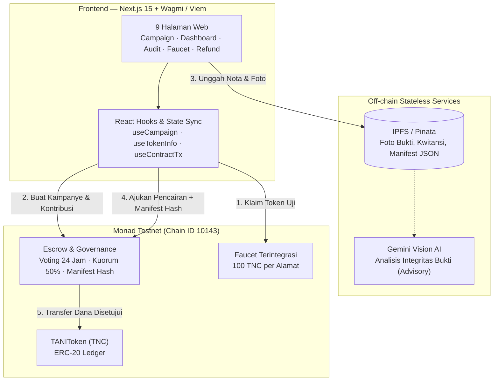

<div align="center">

# 🌾 TaniTrace

<h3>Protokol Pendanaan Pertanian Terdesentralisasi di Monad Testnet</h3>
<p><b>Petani mengajukan dana berkala, investor mengontrol setiap pencairan lewat voting on-chain transparan.</b></p>

<p>
<a href="https://github.com/fardannozami/tani-trace"></a>
<a href="https://docs.monad.xyz/developer-essentials/testnet"></a>
<a href="https://sourcify-api-monad.blockvision.org/verify-ui/jobs/ca5c2012-acd9-4c72-8120-77988677d919"></a>


</p>

<p>


</p>

<b><a href="#-coba-sekarang-quickstart">Coba Sekarang</a></b> ·
<a href="#-masalah--solusi">Masalah & Solusi</a> ·
<a href="#-mengapa-monad">Mengapa Monad?</a> ·
<a href="#%EF%B8%8F-arsitektur--alur-data">Arsitektur</a> ·
<a href="#-smart-contract--on-chain-deployments">Kontrak Terdeploy</a> ·
<a href="#-skenario-demo-3-menit">Demo</a> ·
<a href="#-pengujian--keamanan">Keamanan & Test</a>

<sub>Monad Blitz · Monad Testnet (Chain ID 10143) · Token Simulasi TNC (Tani Token)</sub>

</div>

---

## 📖 Ringkasan Eksekutif

**TaniTrace** memecahkan masalah mendasar dalam pembiayaan pertanian: *ketiadaan transparansi dan penyalahgunaan dana*. 

Pada model tradisional, dana diserahkan sekaligus di awal tanpa kontrol bertahap. Di TaniTrace:
1. **Escrow Bertahap (Milestone-based):** Dana kontribusi investor dikunci dalam smart contract escrow.
2. **Investor Micro-Governance:** Setiap kali petani membutuhkan dana (misalnya untuk bibit, pupuk, atau upah panen), petani mengunggah bukti ke IPFS dan mengajukan pencairan (*disbursement*).
3. **Voting On-Chain 24 Jam:** Hanya investor yang menyetor ke kampanye tersebut yang berhak memberikan suara (*1 token kontribusi = 1 bobot suara*). Dana hanya cair jika kuorum minimal 50% tercapai dan suara YES mayoritas.
4. **Manifest Kriptografis Anti-Manipulasi:** Setiap detail pengajuan dan CID IPFS di-hash menggunakan Keccak256 (`manifestHash`) on-chain sehingga bukti pengeluaran mustahil diubah diam-diam.
5. **AI Advisory Bersifat Independen:** Analisis nota dan foto via Gemini Vision bersifat *advisory* (hanya panduan bagi investor) dan tidak memiliki hak memblokir eksekusi on-chain.

---

## ⚡ Mengapa Monad?

Model micro-governance dan pencairan bertahap seperti TaniTrace **tidak layak dibangun di atas Ethereum L1 atau L2 konvensional** karena:
- **Biaya Gas Mikro:** Mengajukan pencairan $30 untuk pupuk tidak masuk akal jika biaya voting on-chain mencapai $10–$20. Di **Monad**, biaya transaksi fraksional memungkinkan setiap pengeluaran kecil diaudit secara on-chain.
- **Throughput 10.000 TPS & Parallel Execution:** Ketika ratusan kampanye tani berjalan serentak dan ribuan investor melakukan voting bersamaan, Monad memproses state access secara paralel tanpa kemacetan.
- **Sub-Second Finality (~400ms Block Time):** Validasi voting, emisi event audit, dan pencairan dana terjadi instan bagi petani di lapangan tanpa menunggu jeda blok yang lama.

---

## 🚀 Coba Sekarang (Quickstart)

Hanya perlu browser dan wallet (MetaMask / Rabby / Phantom) yang terhubung ke Monad Testnet. Tidak memerlukan saldo uang sungguhan.

### Parameter Jaringan Monad Testnet

| Parameter | Nilai |
|---|---|
| **Network Name** | Monad Testnet |
| **RPC URL** | `https://testnet-rpc.monad.xyz` |
| **Chain ID** | `10143` |
| **Currency Symbol** | `MON` |
| **Block Explorer** | `https://testnet.monadexplorer.com` |
| **Faucet MON Resmi** | `https://faucet.monad.xyz` |

---

## 📜 Smart Contract & On-Chain Deployments

Semua smart contract telah terdeploy dan diverifikasi di **Monad Testnet (Chain ID 10143)**.

### 🌟 Kontrak Utama: `TANIToken` (All-in-One Architecture)
*Mengintegrasikan fungsi ERC-20, Faucet instan, dan Escrow Funding dalam 1 kontrak gas-efficient:*

| Informasi | Nilai / Tautan Explorer |
|---|---|
| **Nama & Simbol** | Tani Token (`TNC`) · 18 Desimal |
| **Alamat Kontrak** | [`0x20e5649E5A3aE0E030A1E16123551D552EA33279`](https://testnet.monadexplorer.com/address/0x20e5649E5A3aE0E030A1E16123551D552EA33279) |
| **Tx Deployment** | [`0x70884f5c7db9cf9a26c910a1e0bdaf026c6e9cb78bb8f3d9e017f36e9b552e88`](https://testnet.monadexplorer.com/tx/0x70884f5c7db9cf9a26c910a1e0bdaf026c6e9cb78bb8f3d9e017f36e9b552e88) |
| **Blok Deploy** | `73747664` |
| **Verifikasi Sourcify** | [Job ID: `ca5c2012-acd9-4c72-8120-77988677d919`](https://sourcify-api-monad.blockvision.org/verify-ui/jobs/ca5c2012-acd9-4c72-8120-77988677d919) |
| **Total Pasokan** | `1.000.000 TNC` (Alokasi Faucet: `200.000 TNC`, Klaim: `100 TNC`/alamat) |

### 🏛️ Kontrak Modular (Multi-Contract Architecture)
*Tersedia pula opsi arsitektur terpisah 3 kontrak:*
- **TANIToken (TNC):** [`0x25e6a951D7a3d7F5C76BF24E098E7878f37007f3`](https://testnet.monadexplorer.com/address/0x25e6a951D7a3d7F5C76BF24E098E7878f37007f3)
- **TaniTraceFunding:** [`0xE4b10b2b7185042F671Aee32aa3E941544A8675d`](https://testnet.monadexplorer.com/address/0xE4b10b2b7185042F671Aee32aa3E941544A8675d)
- **TANIFaucet:** [`0xBF28435F8654ece0A0C37a3476b682dFd596Eb52`](https://testnet.monadexplorer.com/address/0xBF28435F8654ece0A0C37a3476b682dFd596Eb52)

---

## 🏗️ Arsitektur & Alur Data



### Aturan Bisnis & Mekanisme Konsensus

1. **Pembuatan Kampanye:** Petani menetapkan target dana (`targetAmount`), tenggat waktu (`fundingDeadline`), serta deskripsi rencana tanam.
2. **Pengumpulan Dana:** Investor menyetor `TNC`. Jika `totalRaised == targetAmount`, status otomatis menjadi `ACTIVE`.
3. **Penanganan Tenggat & Refund:** Jika tenggat waktu lewat tanpa mencapai target, status beralih ke `FAILED`. Seluruh kontributor dapat langsung memanggil `claimRefund` untuk menarik 100% dananya tanpa potongan.
4. **Pengajuan Pencairan:** Petani hanya dapat mengajukan nominal $\le$ saldo escrow yang tersisa.
5. **Guard Pengajuan Tunggal:** Maksimal hanya boleh ada **1 pengajuan aktif** (`pendingRequestId`) dan **1 pengajuan yang disetujui namun belum ditarik** (`approvedRequestId`) dalam satu waktu, mencegah serangan spam pencairan serentak.
6. **Voting Investor:** Kuorum dihitung secara matematis dengan pembulatan ke atas:
   $$\text{Kuorum} = \left\lceil \frac{\text{totalRaised} \times 5000}{10000} \right\rceil$$
   Pengajuan disetujui (`APPROVED`) jika dan hanya jika total suara mencapai kuorum dan bobot `YES > NO`.

---

## 📱 Skenario Demo (3 Menit)

| Tahap | Peran | Tindakan | Hasil On-Chain |
|:---:|---|---|---|
| **1** | Investor | Buka `/faucet` dan klik **Klaim TNC** | Saldo bertambah +100 TNC |
| **2** | Petani | Buka `/campaigns/new`, isi target & deadline | Event `CampaignCreated`, status `FUNDING` |
| **3** | Investor | Buka detail kampanye, setor TNC sampai target | Event `ContributionMade`, status berubah otomatis jadi `ACTIVE` |
| **4** | Petani | Buka `/dashboard`, unggah nota & foto bibit, ajukan pencairan | Event `DisbursementRequested`, `manifestHash` tercatat on-chain |
| **5** | Investor | Buka detail request, verifikasi kecocokan hash, pilih **Setuju (YES)** | Event `VoteCast` dengan bobot sesuai nominal kontribusi |
| **6** | Siapa saja | Klik **Finalisasi Pengajuan** setelah masa voting | Event `RequestFinalized` $\rightarrow$ Status `APPROVED` |
| **7** | Petani | Klik **Cairkan Dana** pada pengajuan yang disetujui | Event `DisbursementPaid`, dana TNC ditransfer ke wallet petani |
| **8** | Publik | Buka `/audit` | Seluruh rekaman audit trail dan tautan explorer tampil transparan |

*Catatan: Pada lingkungan simulasi lokal Anvil, waktu voting dapat dimajukan via: `cast rpc evm_increaseTime 86401 && cast rpc evm_mine`.*

---

## 🧪 Pengujian & Keamanan

### Cakupan Uji (Test Coverage)

```bash
cd contracts && forge test --via-ir
```

```text
Ran 35 tests for test/TANIToken.t.sol:TANITokenTest
[PASS] testFuzz_Transfer(uint96) (runs: 256)
[PASS] test_ClaimFaucetSuccess()
[PASS] test_ClaimFaucetAlreadyClaimed()
[PASS] test_ClaimFaucetWhenEmpty()
[PASS] test_CreateCampaign()
[PASS] test_CreateCampaignStringValidation()
[PASS] test_ContributeAndActivate()
[PASS] test_ContributeExceedRemainingReverts()
[PASS] test_FinalizeCampaignUnderTargetBecomesFailed()
[PASS] test_RequestDisbursementSuccess()
[PASS] test_RequestDisbursementExceedsEscrowReverts()
[PASS] test_RequestDisbursementNoDuplicatePending()
[PASS] test_VoteSuccess()
[PASS] test_VoteDuplicateReverts()
[PASS] test_VoteNotContributorReverts()
[PASS] test_FinalizeRequestApproved()
[PASS] test_FinalizeRequestExpiredQuorumNotMet()
[PASS] test_FinalizeRequestRejected()
[PASS] test_PayDisbursementSuccess()
[PASS] test_PayDisbursementNotFarmerReverts()
[PASS] test_ClaimRefundSuccess()
[PASS] test_CompleteCampaignSuccess()
[PASS] test_PaginationCampaignIds()
[PASS] test_PaginationContributors()
[PASS] test_ManifestHashConsistency()
...
Suite result: ok. 35 passed; 0 failed; 0 skipped
```

### Pola Keamanan yang Diterapkan

- **Checks-Effects-Interactions (CEI) & ReentrancyGuard:** Mencegah serangan reentrancy pada seluruh fungsi transfer dana (`contribute`, `payDisbursement`, `claimRefund`, `claim`).
- **Pemisahan Akuntansi Saldo (Dual-Ledger Accounting):** Saldo penampung faucet (`faucetRemaining`) dan saldo escrow kampanye (`totalEscrowed`) diisolasi secara ketat sehingga klaim faucet gratis tidak dapat menyedot dana escrow milik petani.
- **Batas Panjang Karakter (`MAX_*_LENGTH`):** Judul, jenis tanaman, lokasi, rencana kerja, dan CID IPFS dibatasi panjangnya untuk mengeliminasi potensi eksploitasi gas griefing pada loop penyimpanan calldata.
- **Anti Fee-on-Transfer:** Memverifikasi selisih saldo aktual `before` dan `after` transfer untuk menggagalkan transaksi token yang mengenakan potongan biaya tersembunyi.
- **Manifest Hash Immutability:** Formula komitmen on-chain:
  $$\text{manifestHash} = \text{keccak256}(\text{keccak256}(\text{"TaniTrace.DisbursementManifest.v1"}), \text{campaignId}, \text{requestId}, \text{farmer}, \text{amount}, \text{purpose}, \text{evidenceCid}, \text{requestedAt})$$

---

## 💻 Menjalankan di Lokal (Panduan Langkah demi Langkah)

### 1. Prasyarat
- Git
- Node.js 20+ & npm / bun
- Foundry (`forge` & `cast`)

### 2. Kloning & Pemasangan Dependensi

```bash
git clone https://github.com/fardannozami/tani-trace.git
cd tani-trace
```

### 3. Kompilasi & Pengujian Smart Contract

```bash
cd contracts
forge build --via-ir
forge test --via-ir
cd ..
```

### 4. Konfigurasi Lingkungan Frontend (`apps/web/.env.local`)

Salin konfigurasi default atau gunakan alamat yang telah aktif:

```env
NEXT_PUBLIC_MONAD_TESTNET_RPC=https://testnet-rpc.monad.xyz
NEXT_PUBLIC_TOKEN_ADDRESS=0x20e5649E5A3aE0E030A1E16123551D552EA33279
NEXT_PUBLIC_FUNDING_ADDRESS=0x20e5649E5A3aE0E030A1E16123551D552EA33279
NEXT_PUBLIC_FAUCET_ADDRESS=0x20e5649E5A3aE0E030A1E16123551D552EA33279
NEXT_PUBLIC_DEPLOY_BLOCK=73747664
NEXT_PUBLIC_IPFS_GATEWAY=https://gateway.pinata.cloud
```

### 5. Menjalankan Frontend

```bash
cd apps/web
npm install
npm run dev
```
Buka browser pada `http://localhost:3000`.

---

## 🗂️ Struktur Direktori Proyek

```text
├── contracts/                  # Smart Contracts (Foundry)
│   ├── src/
│   │   └── TANIToken.sol       # Kontrak All-in-One (ERC20, Faucet, Escrow Funding)
│   ├── test/
│   │   └── TANIToken.t.sol     # 35 Unit & Fuzz Tests komprehensif
│   ├── script/
│   │   └── Deploy.s.sol        # Skrip deployment otomatis Monad Testnet
│   └── foundry.toml            # Konfigurasi Foundry & compiler Solc 0.8.28
├── apps/web/                   # Web Application (Next.js 15 App Router)
│   ├── app/                    # Halaman navigasi & route handler stateless
│   ├── components/             # Komponen UI modular (Campaign, Wallet, Status)
│   ├── hooks/                  # Custom hooks Wagmi & Viem on-chain read/write
│   └── lib/                    # ABI sinkronisasi, formatters, dan manifest verifier
├── deployments/                # Catatan deployment resmi Monad Testnet
└── docs/                       # Dokumentasi arsitektur, PRD, dan panduan demo
```

---

<div align="center">
<sub>Dibangun dengan dedikasi untuk ekosistem <b>Monad</b>. Memajukan kedaulatan pangan dan transparansi pembiayaan pertanian.</sub>
</div>
